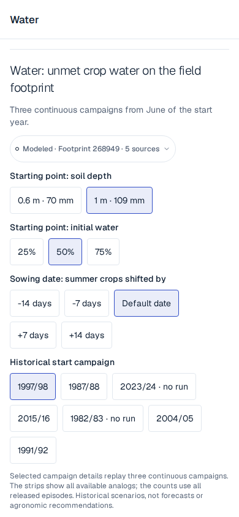
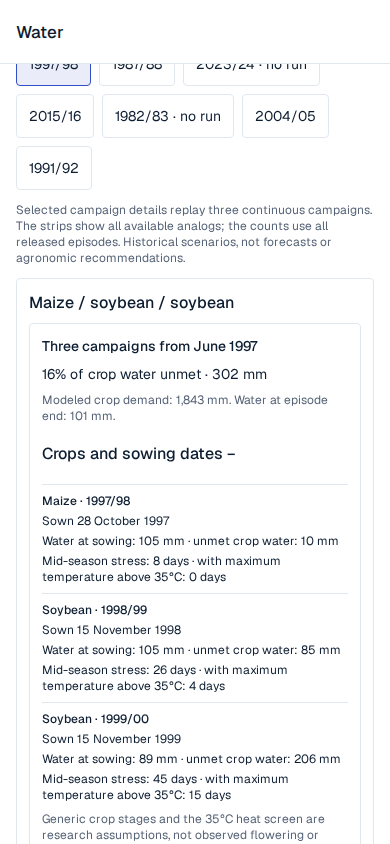
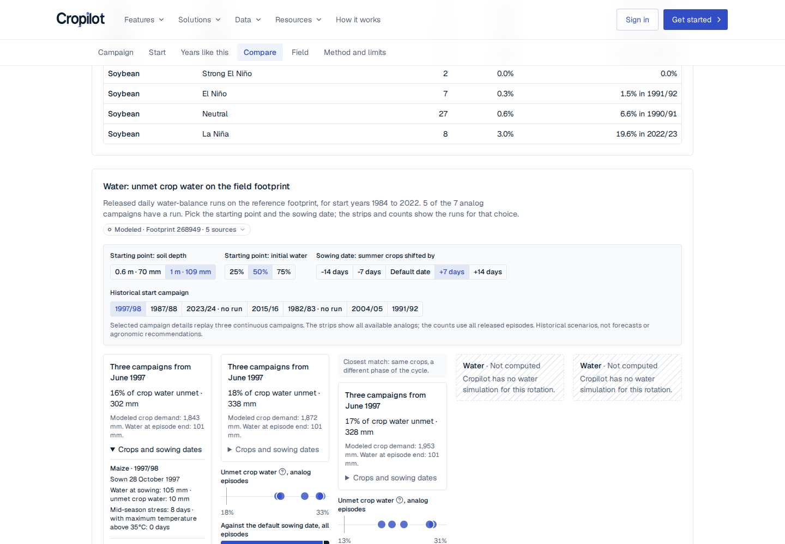

# Water, mobile and MCP integration verification

Verified locally on 2026-11-15. This contribution is based on `feat/mobile-demo-case`
(`61892a0`); its PR targets that branch so the team's existing mobile implementation
remains a separate change. Nothing has been merged or deployed by this verification.

## Changes

- Web and mobile use the same exact water-scenario selector: strategy, campaign, profile
  depth, initial reserve and sowing shift. Crop details retain dates, water at sowing,
  deficit, stress/heat days and the released run ID. No new simulation or model training.
- Reselecting the same profile preserves a valid sowing shift. Moving to a profile without
  shifted runs resets to the default date with a visible explanation. Missing campaigns
  and unsimulated rotations remain explicitly unavailable.
- Mobile opens a public demonstration without pretending to create an account or sign in
  with Google. Water evidence is available in a source sheet beside the controls.
- Four public read-only [MCP tools](mcp.md) expose the existing case evidence. Private API
  authentication is unchanged. A [deployment runbook](deployment.md) and executable
  provisioning/deployment/smoke scripts prepare the stack for a VPS.

## Automated and runtime checks

Run application checks from the repository root with Node 24 and pnpm 12.15.0. Python
checks used the backend's Python 3.14 environment, with external `PYTHONPATH`/`PYTHONHOME`
unset. The existing scientific environment remains isolated on Python 3.12.7.

| Check                                             | Observed result                                                                                                                               |
| ------------------------------------------------- | --------------------------------------------------------------------------------------------------------------------------------------------- |
| `pnpm lint`                                       | Pass: Biome, Ruff and both design-rule checks                                                                                                 |
| `pnpm typecheck`                                  | Pass: backend, auth, shared API, mobile and web                                                                                               |
| `pnpm test`                                       | 77 backend tests passed, 5 skipped; 12 shared API tests passed                                                                                |
| `pnpm build`                                      | Pass; existing large MapLibre chunk warning remains                                                                                           |
| `pnpm generate`                                   | Generated OpenAPI and client unchanged                                                                                                        |
| Scientific `python -m pytest experiments -q`      | 17 passed with the pinned scientific environment                                                                                              |
| MCP contract / HTTP tests                         | 34 passed, included in the backend total                                                                                                      |
| Actual SDK client through the web origin          | All four tools returned structured evidence                                                                                                   |
| Independent water/MCP review                      | All 10 released settings and 150 selected analog episodes match the public bundle                                                             |
| Production Compose, shell syntax and smoke script | Configuration and syntax checks passed                                                                                                        |
| Frozen release provisioning                       | Archive and all 1,173 files verified; repeat verification passed; corrupt archive rejected without replacing installation                     |
| Production image builds                           | Backend, auth and web built successfully                                                                                                      |
| Production image runtime                          | Frozen water assets verified as the unprivileged backend user through read-only mounts; nginx health check passed                             |
| Public smoke                                      | All 10 regions, web routes, auth health/JWKS, unknown case 404, unauthenticated private water 401, MCP discovery and water comparison passed  |
| Deployment source guard                           | Clean source with ignored settings/assets passes; tracked, staged and non-ignored untracked source changes are refused without deleting files |

The five skipped backend tests require the separate regional water/soil-wetness frozen
inference environment; it was not installed in this integration worktree. Historical
strategy-result tests ran with the installed release. The complete production image
build initially hit local Docker bridge DNS errors; it passed using a temporary build
network override outside Git. No network workaround was added to production configuration.

## Browser verification

The Browser plugin was unavailable in this session. Verification used the bundled
Playwright/Chromium runtime, without adding a product dependency. Web was exercised at
1440 × 1000 and 390 × 844; the mobile application was exercised through Expo Web at
390 × 844. Local API/auth/database services were running, with a temporary same-origin
proxy for Expo Web. No product CORS policy was changed.

1. Enter through Get started → Open the demo; navigate Home, Years, Strategies and Map.
2. Open water from Strategies, inspect its evidence sheet and return to the tab.
3. Open a historical campaign and a map lot; inspect crop history and NDVI.
4. On web and mobile, inspect Pergamino's reference rotation starting in 1997/98:
   the default 1 m / 50% scenario shows 19% unmet crop water, 366 mm. The +7-day
   scenario shows 16%, 302 mm; its first maize sowing moves to 28 October 1997.
5. Reselect 1 m and 50%; the +7-day result stays selected. Change to 0.6 m: the
   default-date notice appears, unavailable shifts are disabled and the result is
   25%, 481 mm. These values summarize three continuous historical campaigns.
6. Select 2023/24: three explicit missing-run states, plus two rotations with no water
   simulation. No fallback to another campaign's results.
7. Check unknown regions on web and mobile. Simulate HTTP 503 on mobile: an unavailable
   state appears with no water figures; reload after restoring the API recovers the data.
8. Hold the mobile API response: a loading indicator appears without results, followed
   by the actual data after release. Check for horizontal page overflow at both widths.

The final scenario matrix and navigation/failure checks passed with no unexpected browser
errors. A first concurrent browser run caught the generator briefly replacing API files;
it was repeated successfully after generation finished. Do not regenerate the shared client
while recording a live development preview.

## Screenshots

Actual application captures from the checks above; no generated imagery.

Mobile controls and selected historical crop details:

Web water comparison:

## Remaining validation

No VPS or credits have been activated, so public DNS, HTTPS, remote deployment and
seven-day availability remain unverified. Google OAuth was not exercised. Expo Web
verification does not establish Android/iOS device behavior, safe areas, native gestures,
store packaging or physical-phone connectivity. No load, uptime or accessibility-conformance
claim is made. Existing historical-model limitations still apply; these screens do not
provide current field measurements, forecasts or agronomic recommendations.
