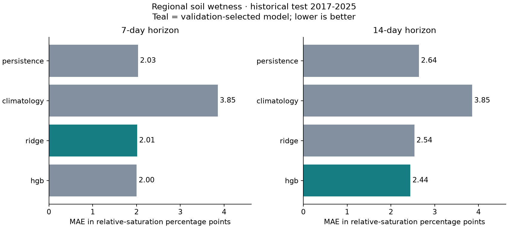

# Regional soil wetness at 7 and 14 days

Two additional research models were trained on the frozen NASA POWER snapshot:
ten Argentine points, 1984–2025. They estimate **GWETROOT at t+7 and t+14** from
information ending at t. GWETROOT is regional root-zone relative saturation
on a 0–1 scale. It is not measured farm moisture, volumetric moisture or irrigation demand.

The models are available on `modelos`, alongside the existing seasonal water/heat
models and physical rotation-water simulator. They add no screens or HTTP routes.

## Install and run

First complete the existing [water model installation](models.md). Then, from the
repository root:

```sh
uv run --directory apps/backend python -m app.modules.water.cli moisture-setup
uv run --directory apps/backend python -m app.modules.water.cli moisture-verify
uv run --directory apps/backend python -m app.modules.water.cli moisture
```

The installer retrieves the private [models-moisture-v1 prerelease](https://github.com/HomoSapiens-NASA-Challenge/cropilot/releases/tag/models-moisture-v1)
using authenticated `gh`, checks the archive and every file, and reuses the
original Python 3.12.7 environment. Weights and frozen runtime go into
`apps/backend/models/moisture-v1/`; daily test predictions go into
`apps/backend/data/moisture-v1/`. Both are outside Git. Existing releases are
preserved. With custom water storage paths, these directories are siblings of
the corresponding `water-v1` roots; overlapping paths are rejected.

For offline asset installation, pass `moisture-setup --archive /absolute/path/cropilot-moisture-models-v1.tar.gz`.
The water runtime and its pinned dependencies must already be installed.

Backend integration is synchronous, using `app.modules.water.moisture.predict_moisture(request)`.
Call from a synchronous handler or a worker. The CLI accepts
`moisture --request /absolute/path/request.json`.

- [Example request](../apps/backend/app/modules/water/resources/moisture-request.example.json)
- [Frozen response](../apps/backend/app/modules/water/resources/moisture-response.example.json)
- [Metrics and source hashes](../apps/backend/app/modules/water/resources/moisture-metrics.json)
- [Release checksum and file manifest](../apps/backend/app/modules/water/resources/moisture-release.json)
- [Protocol fixed before training](moisture-protocol.md)

The example uses Pergamino data ending **2025-11-01**. It is a historical example,
not today's forecast. The response includes the target dates, expected change,
selected method, provenance and an exploratory 90% residual interval.
The caller must construct features with `experiments/moisture.py:features` from
complete, validated daily data. A polygon alone is not an input.
The contract rejects unknown points, extra features, nonfinite values, invalid
units, mismatched coordinates/season, and dates outside the evaluated history.
It cannot prove the provenance of manually supplied numbers.

## Held-out results

All errors below are **percentage points of relative saturation**: 0.020 in the
0–1 target scale equals 2.0 percentage points. Lower is better.

| Horizon | Selected on validation      | Persistence MAE | Model MAE | Relative error reduction | Interval test coverage |
| ------- | --------------------------- | --------------: | --------: | -----------------------: | ---------------------: |
| 7 days  | Ridge                       |           2.033 |     2.012 |                     1.0% |                  90.8% |
| 14 days | Histogram gradient boosting |           2.639 |     2.443 |                     7.4% |                  90.7% |



The 7-day improvement is **not clear**: its exploratory paired annual bootstrap
95% interval is **−0.010 to +0.053 percentage points**. For 14 days it is
**+0.132 to +0.262 percentage points**. These intervals resample nine complete
test years (2,000 replicates), preserve within-year spatial/daily dependence,
and do not address persistence across consecutive years or multiple comparisons.

Nominal 90% intervals use the calibration-period absolute residual quantile,
with a conservative finite-sample order statistic. Mean test widths are
8.775 and 10.671 percentage points, respectively. Coverage is an empirical
historical result, not a guarantee for future dates or individual farms.

The 7-day HGB candidate has validation MAE 2.002 and test MAE 2.001
percentage points, while Ridge validation MAE is 1.987. Selection remains Ridge;
the test result was not used to change it. All four candidates per horizon
(persistence, monthly regional climatology, Ridge and HGB) remain frozen.

**Spatial transfer did not beat persistence.** Training HGB on nine points and
testing the excluded point in 2017–2025 gave mean zone MAE 2.141 versus 2.033
at seven days, and 2.675 versus 2.639 at fourteen days. This diagnostic does
not validate new locations. The production-facing wrapper accepts only the
ten registered regional points, and still labels all results `research_only`.

## Data and experiment

The same 153,410 NASA daily point records used by `models-water-v1` were reused;
no new dataset, forecast provider, ONI predictor or farm sensor was introduced.
NASA response units, date completeness, fill values and physical bounds were
checked with the original validator. ET0 is the existing FAO-56 implementation
with mean relative humidity approximation. This is not a separate water-balance model.

Features include present and lagged wetness (1/7/14/28 days), trailing wetness
means, rain and reference ET sums (7/14/28 days), mean temperatures (7/28 days),
coordinates and annual sine/cosine. No future weather or target appears in them.
Ridge and HGB learn the change from current wetness; final estimates are clipped
to [0,1]. The input history includes weather of day t, so these are end-of-day
estimates relative to t, not start-of-day estimates.

| Partition   | Origin/target years | 7-day rows | 14-day rows | Purpose                                 |
| ----------- | ------------------- | ---------: | ----------: | --------------------------------------- |
| Train       | 1984–2006           |     83,660 |      83,590 | Fit estimators, scaling and climatology |
| Validation  | 2007–2012           |     21,850 |      21,780 | Select lowest-MAE candidate             |
| Calibration | 2013–2016           |     14,540 |      14,470 | Estimate residual intervals             |
| Test        | 2017–2025           |     32,800 |      32,730 | Frozen final evaluation                 |

Origins whose target crosses a partition boundary are removed. Features may
use preceding historical days; future labels never cross into another split.
All locations share temporal boundaries. There are many correlated daily
rows, not that many independent weather events.

Ridge uses scaled inputs and alpha=100. HGB uses 160 iterations, learning rate
0.05, at most 15 leaves, at least 50 rows per leaf, L2=10, seed 42, and no random
early stopping. Settings were fixed before training. There was no tuning on
test and no refit on calibration/test. The twenty additional leave-one-zone-out
HGB fits are diagnostics, not candidates selected for deployment.

## Limits that must remain visible

- **Availability:** the sources are revised reanalysis. NASA describes MERRA-2
  monthly data becoming available around the middle of the following month;
  POWER's historical as-issued availability was not audited. A +7/+14-day
  target can precede publication of its input. These results therefore support
  historical predictability research, **not an operational short-range forecast**.
- **Scale:** ten hand-selected regional points, not farm polygons or averages
  over departments. NASA model-to-model accuracy does not demonstrate field accuracy.
- **No agronomic recommendation:** no crop outcome, irrigation amount, flooding
  probability, water quality, yield or rotation benefit is inferred from GWETROOT.
- Seven-day gains are small; unfamiliar locations perform worse than persistence.
  Keep baselines and uncertainty visible before considering any product integration.

## Reproduce and validate

After water setup, run from `apps/backend` in a clean environment (the shell
commands below clear foreign Python paths only for these processes):

```sh
uv run python -m app.modules.water.cli verify
env -u PYTHONPATH -u PYTHONHOME PYTHONDONTWRITEBYTECODE=1 .venv-models/bin/python -m pytest experiments -q
env -u PYTHONPATH -u PYTHONHOME PYTHONDONTWRITEBYTECODE=1 OMP_NUM_THREADS=2 OPENBLAS_NUM_THREADS=2 .venv-models/bin/python experiments/moisture.py train --data-dir data/water-v1/regional --upstream models/water-v1/runtime/research/ml-investigacion/enso-lab --output data/moisture-reproduction
```

Training refuses an existing output directory. Never overwrite the published
evidence. `experiments/package_moisture.py` is the maintainer's packaging tool;
it refuses a runtime source that differs from the one recorded during training.
Scientific tests run in the model environment; API types/tests run in Python 3.14.
CI runs the synthetic scientific safeguards without downloading private assets.

## Sources and AI use

- [NASA GMAO MERRA-2 FAQ](https://gmao.gsfc.nasa.gov/gmao-products/merra-2/faq_merra-2/):
  GWETROOT interpretation and publication-lag warning.
- [NASA POWER daily API](https://power.larc.nasa.gov/docs/services/api/temporal/daily/):
  original weather/wetness snapshot; per-file hashes in metrics, URLs and
  acquisition metadata in the existing water release's `sources.json`.
- [FAO-56](https://www.fao.org/4/x0490e/x0490e00.htm): reference ET; reused team
  implementation and source revision are pinned in `models-water-v1`.
- [scikit-learn 1.9.1](https://scikit-learn.org/stable/): Ridge and HGB.
  NumPy, pandas, SciPy, joblib, threadpoolctl, Matplotlib and pytest retain the
  exact versions in the existing model environment lock.
- Codex (OpenAI) assisted with the protocol, training pipeline, tests, evaluation,
  chart, packaging and documentation. The chart is generated from measured
  experimental results. No synthetic data was used to train the published models.
